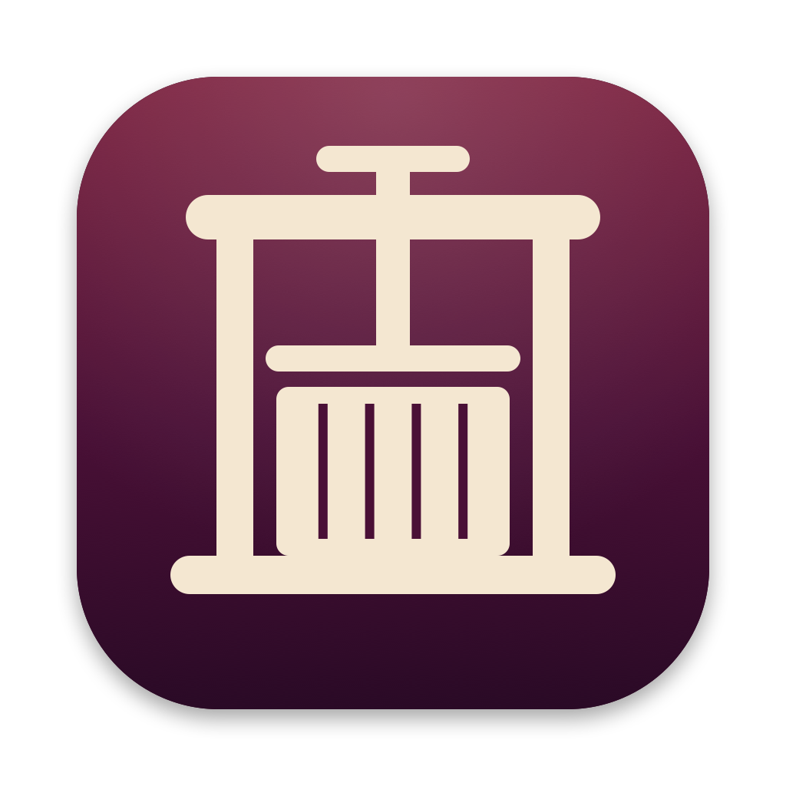
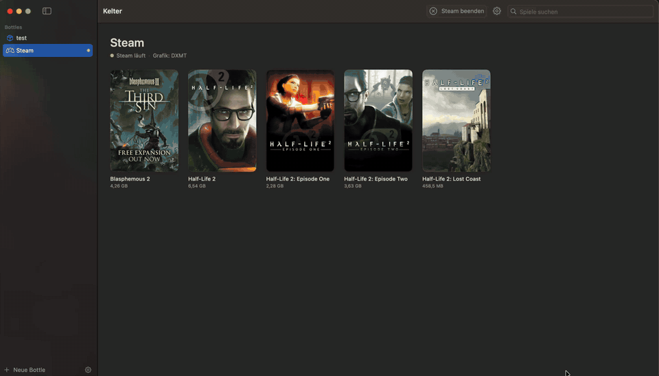
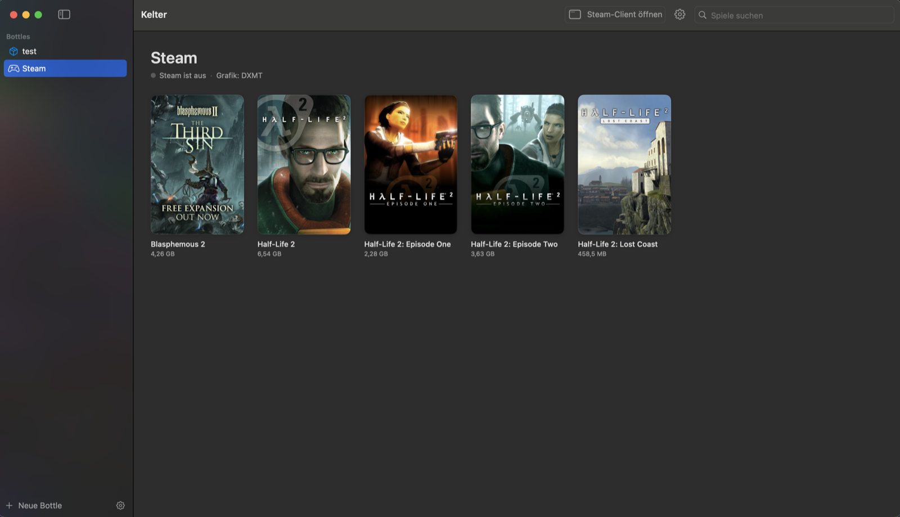

<p align="center">
  
</p>

# Kelter

[English](README.md) · **Deutsch**

Kelter startet Windows-Spiele aus deiner Steam-Bibliothek auf Macs mit Apple
Silicon. Es richtet [Wine](https://www.winehq.org) und den Windows-Client von
Steam mit wenigen Klicks ein, zeigt deine Spiele mit ihren Covern und
startet sie über Steam. Eine freie Alternative zu CrossOver, unter der GPLv3.

Kelter ist nur die Oberfläche. Wine und die Grafikschichten lädt es als
fertige, gepflegte Builds aus dem Netz; Herkunft, Version und Prüfsumme stehen
in einer Konfigurationsdatei. Proprietäre Bestandteile liefert Kelter nicht
mit.

<p align="center">
  
</p>

> **Stand:** frühe Version (0.1). Steam, die Spielebibliothek und DirectX
> 9–11 laufen; DirectX 12 noch nicht. Die App gibt es zum
> [Herunterladen](#installieren), oder du baust sie aus dem Quelltext.

Kelter ist ein unabhängiges Projekt und steht in keiner Verbindung zu Valve,
Apple oder CodeWeavers. Steam, macOS, DirectX und CrossOver sind Marken ihrer
jeweiligen Inhaber.

## Inhalt

- [Was funktioniert](#was-funktioniert)
- [Voraussetzungen](#voraussetzungen)
- [Installieren](#installieren)
- [Bedienung](#bedienung)
- [Wenn ein Spiel nicht startet](#wenn-ein-spiel-nicht-startet)
- [Grenzen](#grenzen)
- [Technik](#technik)
- [Mitmachen](#mitmachen)
- [Herkunft und Lizenzen](#herkunft-und-lizenzen)

## Was funktioniert

Getestet auf einem MacBook Air (M5) mit macOS 26.6, Wine Staging 11.21.

| Bereich | Stand | Auf echtem Mac geprüft |
| --- | --- | --- |
| Einrichtung: Rosetta 2, Wine laden, Bottles anlegen | fertig | ja |
| Steam installieren, anmelden, starten, sauber beenden | fertig | ja |
| Spielebibliothek mit Covern, Start per Klick, Suche | fertig | ja |
| Grafik „Wine (eingebaut)“ (DirectX 9–11 über OpenGL) | fertig | ja (Half-Life 2) |
| Grafik „DXMT“ (DirectX 10/11 über Metal) | fertig | ja (Blasphemous 2, 60 FPS) |
| Grafik „D3DMetal“ (DirectX 11/12, Apple) | eingebaut, pausiert: Steam stürzt damit ab | ja, mit diesem Ergebnis |
| Winetricks (Visual C++, Schriften …) | fertig | ja (Test-Bottle) |
| Umgebungsvariablen und DLL-Overrides pro Bottle | fertig | Oberfläche ja |
| Hinweis auf Kernel-Anti-Cheat | fertig | noch nicht mit einem betroffenen Spiel |
| Oberfläche auf Deutsch und Englisch | fertig | ja |
| Einstellungen pro Spiel | zurückgestellt | – |
| Controller | nicht dokumentiert | – |

### Getestete Spiele

| Spiel | DirectX | Grafik in Kelter | Ergebnis |
| --- | --- | --- | --- |
| Blasphemous 2 | 11 | DXMT | läuft, 60 FPS |
| Half-Life 2 (mit Episoden) | 9 | Wine (eingebaut) | läuft, gelegentliche Ruckler beim Nachladen |

Erfahrungen mit weiteren Spielen sind willkommen, siehe [Mitmachen](#mitmachen).

## Voraussetzungen

**Zum Benutzen**

- Mac mit Apple Silicon (M1 oder neuer), macOS 15 oder neuer
- Rosetta 2 (Kelter bietet die Installation an)
- rund 2 GB freier Platz für Wine, dazu der Platz für deine Spiele

**Zum Bauen**

- Xcode oder die Command Line Tools mit Swift 5.9 oder neuer
- Für Winetricks: [Homebrew](https://brew.sh) und `brew install cabextract`
- Nur um Kelters Wine-Dateien selbst zu bauen (sonst lädt Kelter sie):
  `brew install bison mingw-w64`, siehe
  [Kelters Anpassungen an Wine](#kelters-anpassungen-an-wine)

## Installieren

### Herunterladen

1. `Kelter-<Version>.zip` aus dem
   [neuesten Release](https://github.com/blankfourdigits/Kelter/releases/latest)
   laden und entpacken.
2. `Kelter.app` **vor** dem ersten Start in den Programme-Ordner ziehen.
   Direkt aus „Downloads“ gestartet, führt macOS die App aus einer
   versteckten, schreibgeschützten Kopie aus, jedes Mal an einem anderen Ort.
3. **Erster Start:** Kelter ist freie Software und nicht von Apple
   beglaubigt. macOS blockiert deshalb den ersten Start mit der Meldung, die
   App lasse sich nicht überprüfen. Auf **Fertig** klicken, dann
   **Systemeinstellungen → Datenschutz & Sicherheit** öffnen, nach unten
   scrollen, bei der Meldung zu Kelter auf **Trotzdem öffnen** klicken und
   bestätigen. Das ist nur einmal nötig.

   Alternativ im Terminal:
   `xattr -dr com.apple.quarantine /Applications/Kelter.app`

### Aus dem Quelltext bauen

```sh
git clone https://github.com/blankfourdigits/Kelter.git
cd Kelter
bash scripts/make-app.sh
open build/Kelter.app
```

`make-app.sh` baut Kelter und legt `build/Kelter.app` an. Die App lässt sich
von dort in den Programme-Ordner ziehen. Eine selbst gebaute App startet ohne
den Gatekeeper-Schritt oben.

## Bedienung

1. **Erster Start:** Kelter führt durch die Einrichtung: Rosetta 2, dann
   Wine (rund 250 MB Download). Danach legt „Steam einrichten“ eine Bottle
   an, lädt den Steam-Installer von Valve und startet Steam. Beim ersten
   Start aktualisiert sich Steam selbst; das dauert einige Minuten. Dann im
   Steam-Fenster anmelden und Spiele installieren.
2. **Bibliothek:** Links stehen die Bottles, rechts die Spiele der gewählten
   Bottle. Ein Klick auf ein Cover startet das Spiel über Steam.
   „Steam-Client öffnen“ öffnet nur das Steam-Fenster, etwa zum Installieren.
   Ein grüner Punkt neben der Bottle zeigt, dass gerade etwas darin läuft.
   Die Bibliothek stammt aus Steams Dateien und ist deshalb auch da, wenn
   Steam geschlossen ist.

   
3. **Einstellungen der Bottle** (Zahnrad oben rechts):
   - *Allgemein:* Name, Windows-Version, Windows-Programm starten,
     Wine-Konfiguration, Bottle löschen
   - *Grafik:* Wine (eingebaut) oder DXMT, FPS-Anzeige, Retina-Modus
   - *Winetricks:* Visual C++, DirectX-Zusätze, Schriften mit einem Klick
   - *Erweitert:* Startparameter für Steam, Umgebungsvariablen,
     DLL-Overrides, ausführliches Log
4. **Andere Windows-Programme:** eine `.exe` oder `.msi` auf das Fenster
   ziehen; sie startet in der gewählten Bottle.
5. **Spiel deinstallieren:** Rechtsklick auf das Cover → „Deinstallieren …“.
   Kelter löscht das Spiel selbst und auf Wunsch auch die lokalen
   Spielstände (Spielstände in der Steam-Cloud bleiben). Steams eigene
   Deinstallation bleibt bei Spielen hängen, die dabei ein 32-Bit-.NET-
   Aufräumprogramm starten, etwa Persona 5 Royal.
6. **Sprache:** Kelter → Einstellungen … (⌘,) oder das Zahnrad unten in der
   Seitenleiste: „Wie das System“, Deutsch oder English. Gilt nach einem
   Neustart, den Kelter anbietet.

**Welche Grafik?** DXMT ist für die meisten Spiele die richtige Wahl: schnell
für DirectX 10 und 11, DirectX 9 läuft dabei weiter über Wine. „Wine
(eingebaut)“ funktioniert mit allem, ist aber langsamer.

**Startparameter für ein einzelnes Spiel** setzt du in Steam selbst:
Rechtsklick auf das Spiel → Eigenschaften → Startoptionen.

**Anti-Cheat:** Spiele mit einem Schutz gegen Schummeln, der tief im System
läuft (Kernel-Anti-Cheat wie Ricochet, BattlEye oder Easy Anti-Cheat),
markiert Kelter orange und fragt vor dem Start nach. Unter Wine auf dem Mac
laufen sie in der Regel nicht.

## Wenn ein Spiel nicht startet

1. In den Einstellungen der Bottle unter *Erweitert* „Ausführliches
   Wine-Log“ einschalten und Steam neu starten.
2. Das Spiel starten und warten, bis es sich beendet oder hängen bleibt.
3. **Darstellung → Testansicht** (⌥⌘T) öffnen. Dort steht das Live-Log, und
   „Diagnose sammeln …“ legt einen Ordner `Kelter-Diagnose-<Datum>-<Zeit>` an:
   Kelters Log, die Einstellungen der Bottle, Steams Logs, laufende
   Wine-Prozesse, installierte Spiele und Systemangaben.
4. Das ausführliche Log danach wieder ausschalten, es wird schnell groß.

Der Diagnose-Ordner bleibt auf deinem Mac. Steams Logs können deinen
Kontonamen enthalten; prüfe den Ordner, bevor du ihn teilst.

Häufige Fälle:

- **Fehlende Windows-Bibliotheken:** In *Winetricks* „Visual C++ 2015–2022“
  oder „Direct3D-Shader-Compiler“ installieren. Meldet Kelter, dass Visual
  C++ schon in neuerer Version installiert ist, hat Steam es bereits
  mitgebracht; dann ist nichts zu tun.
- **Schwarzes Bild oder Absturz beim Start:** die andere Grafik ausprobieren.

## Grenzen

- **DirectX 12** läuft noch nicht. Apples D3DMetal ist eingebaut, aber
  pausiert, weil Steam damit abstürzt (siehe [D3DMetal](#d3dmetal-directx-12)).
- **Kernel-Anti-Cheat** läuft unter Wine nicht; betroffen sind viele
  Mehrspieler-Spiele, etwa Call of Duty, Destiny 2 oder PUBG.
- **Das Steam-Overlay** (Shift+Tab im Spiel) ist abgeschaltet, weil Spiele
  damit unter Wine hängen bleiben.
- **DirectX 9** läuft über OpenGL und ist bei anspruchsvollen Spielen
  langsamer.
- **32-Bit-.NET-Programme** hängen unter Wine auf dem Mac (Wine-Bug 58197),
  etwa manche Launcher und Aufräumprogramme.
- **Controller** sind noch nicht getestet und dokumentiert.
- **Einstellungen pro Spiel** (eigene Grafik oder Umgebung je Spiel) gibt es
  noch nicht; Einstellungen gelten pro Bottle.
- Nur **Apple Silicon**; Intel-Macs werden nicht unterstützt.

## Technik

### Aufbau

```
Sources/
  KelterCore/   Pfade, Konfiguration, Bottles, Logdatei, Übersetzung (nur Foundation)
  KelterWine/   Wine laden und starten, Wine-Kopien mit Grafikschicht,
                Winetricks, Diagnose, Laufzeit-Erkennung
  KelterSteam/  Steam installieren, starten, beenden; Fensterkorrektur;
                Steams Dateien lesen (VDF), Bibliothek, Anti-Cheat-Erkennung
  KelterApp/    SwiftUI-Oberfläche: Bibliothek, Einstellungen, Testansicht
Resources/      runtimes.json, Übersetzungen, Icon, Hilfsbibliothek für Steam
Tools/
  steam-ui-fix/ Quelltext und Bauskript der Hilfsbibliothek für das Steam-Fenster
  wine-patches/ Kelters zwei Patches für Wine und ihr Bauskript
  app-icon/     zeichnet das App-Icon
Tests/          XCTest; Wine selbst wird in Tests nie gestartet
```

- `WineRunner` ist die einzige Stelle, die Wine startet. Er setzt
  `WINEPREFIX`, die Umgebung der Bottle und wählt den Wine-Baum passend zur
  Grafik.
- Wine schreibt in eine Logdatei statt in eine Pipe, weil seine
  Hintergrundprozesse länger leben als das gestartete Programm. Die Oberfläche
  liest die Datei mit.
- `BottleStore` benennt Ordner nach einer ID, nicht nach dem Namen. Umbenennen
  verschiebt deshalb nie eine Windows-Umgebung.
- Ob in einer Bottle etwas läuft, erkennt Kelter an der Verbindung von Wines
  Hintergrunddienst (`/tmp/.wine-<uid>/server-<dev>-<inode>/socket`).

### Wo Kelter Daten ablegt

Alles liegt unter `~/Library/Application Support/Kelter/`:

| Pfad | Inhalt |
| --- | --- |
| `Bottles/<ID>/bottle.json` | Name und Einstellungen einer Bottle |
| `Bottles/<ID>/prefix/` | die Windows-Umgebung (WINEPREFIX) |
| `Runtimes/wine/<Version>/` | das entpackte Wine |
| `Runtimes/wine-variants/` | Kopien von Wine mit einer Grafikschicht |
| `Runtimes/wine-files/` | Kelters gebaute Wine-Dateien |
| `Runtimes/graphics/` | Grafikschichten (DXMT, ggf. D3DMetal) |
| `Runtimes/winetricks/` | das Winetricks-Skript |
| `Downloads/` | Downloads, darunter der Winetricks-Zwischenspeicher |
| `Logs/kelter.log` | Ausgabe von Kelter und Wine |
| `runtimes.json` | optional: eigene Konfiguration, hat Vorrang |

Um Kelter vollständig zu entfernen, genügt es, diesen Ordner und die App zu
löschen.

### Konfiguration: `runtimes.json`

Was Kelter lädt, steht in `Resources/runtimes.json`, nicht im Code. Für
eigene Anpassungen die Datei nach
`~/Library/Application Support/Kelter/runtimes.json` kopieren und ändern.

| Abschnitt | Inhalt |
| --- | --- |
| `schemaVersion` | Aufbau der Datei; steigt bei jeder Strukturänderung |
| `wine` | Wine-Build: Name, Version, URL, Prüfsumme, Ordner im Archiv, ESync/MSync |
| `winePatches` | Version und Revision von Kelters Wine-Anpassungen, Bauskript |
| `graphicsLayers` | Grafikschichten: Download, Prüfsumme, welche Dateien wohin, welche Wine-Anpassungen sie brauchen; bei D3DMetal Lizenz, Disk-Image, `paused` |
| `steam` | Installer, Startparameter und Vorschläge, Fensterkorrektur (`uiFix`), DLL-Overrides (Overlay aus), ausgeblendete Programme (`hiddenAppIDs`) |
| `antiCheat` | Spiel-IDs und typische Dateien für den Anti-Cheat-Hinweis |
| `winetricks` | Version, URL, Prüfsumme, angebotene Pakete, benötigte Programme |
| `support` | Zusatzpaket für Wine-Builds mit eigenen Grafikschichten (derzeit nicht genutzt) |

### Steam unter Wine

**Das Steam-Fenster war schwarz.** Es ist eine eingebettete
Chromium-Oberfläche, die aus einem zweiten Prozess zeichnet; Wines Mac-Treiber
kann das nicht darstellen. Chromiums Schalter `--in-process-gpu` hilft, aber
Steam reicht ihn nicht an Chromium weiter. Kelter legt deshalb vor jedem
Steam-Start eine kleine Hilfsbibliothek (`winmm.dll`) in die Bottle, die nur
`steamwebhelper.exe` lädt. Sie leitet alle Aufrufe an Wines eigenes winmm
weiter und hängt den Schalter an die Kommandozeile an. Steams eigene Dateien
bleiben unverändert. Quelltext: `Tools/steam-ui-fix/winmm_proxy.c`, neu bauen
mit `bash Tools/steam-ui-fix/build.sh` (braucht clang, lld-link und
llvm-dlltool).

Zusätzlich startet Kelter Steam mit `-cef-disable-gpu
-cef-disable-gpu-compositing`; mit Grafikbeschleunigung stürzt Chromiums
Grafikteil unter Wine ab. Das betrifft nur das Steam-Fenster, nicht die
Spiele.

**Das Steam-Overlay** (`gameoverlayrenderer.dll`) ließ Spiele hängen und ist
deshalb abgeschaltet (`steam.dllOverrides`).

**Spiele starten:** Kelter liest Steams Dateien (`libraryfolders.vdf`,
`appmanifest_*.acf`) auch aus Bibliotheken auf anderen Laufwerken, nimmt die
Cover aus Steams Zwischenspeicher und startet ein Spiel mit
`steam.exe steam://rungameid/<id>`. Läuft Steam schon, übernimmt es den Start.

### Grafik

| Auswahl | DirectX 9 | DirectX 10/11 | DirectX 12 |
| --- | --- | --- | --- |
| Wine (eingebaut) | OpenGL | OpenGL | – |
| DXMT | OpenGL | Metal (DXMT) | – |
| D3DMetal (pausiert) | OpenGL | Metal (D3DMetal) | Metal (D3DMetal), nur 64-Bit |

Wine sucht seine eingebauten Bibliotheken zuerst im eigenen Ordner. Eine
Grafikschicht, die `d3d11.dll` ersetzt, muss deshalb in einem Wine-Baum liegen.
Kelter legt pro Schicht eine Kopie von Wine an (auf APFS ein Klon, der kaum
Platz belegt) und startet jede Bottle mit dem Baum, der zu ihrer Wahl passt.
Das Wine der anderen Bottles bleibt unverändert.

#### Kelters Anpassungen an Wine

DXMT braucht eine Funktionstabelle in Wines Mac-Treiber (`macdrv_functions`),
die nur CrossOvers Wine anbietet; ohne sie meldet DXMT „Failed to create metal
view“. Für D3DMetal kommt eine zweite Anpassung in `ntdll.dll` dazu. Beide
Patches liegen in `Tools/wine-patches/` und stehen wie Wine unter der LGPL.
`bash Tools/wine-patches/build.sh` baut die zwei Dateien aus Wine plus Wine
Staging in der Version aus `runtimes.json`. GitHub führt dieses Skript für
jede Revision aus (`.github/workflows/wine-files.yml`) und veröffentlicht
die Dateien zusammen mit dem vollständigen Quelltext als Release; wählst du
DXMT, lädt Kelter sie und prüft die Prüfsumme aus `runtimes.json`. Selbst
gebaute Dateien haben Vorrang (braucht `brew install bison mingw-w64`).
Kelter kopiert die Dateien nur in die Wine-Kopien der Grafikschichten.

#### D3DMetal (DirectX 12)

D3DMetal ist Apples Übersetzung von DirectX 11/12 nach Metal aus dem Game
Porting Toolkit. Es gehört Apple und ist **nicht** Teil von Kelter. Apples
Lizenz erlaubt die Nutzung nur, um Spiele für Apple-Geräte zu entwickeln, zu
testen oder zu bewerten, und die Weitergabe nur ohne kommerziellen Zweck.
Kelter zeigt die Lizenz vor dem Laden, verändert Apples Dateien nicht und
liefert sie nicht mit. Bezugswege: Apples eigenes Disk-Image (mit eigener
Apple-ID) oder ein Download von Gcenx.

**Derzeit pausiert:** Mit D3DMetal stürzt `steam.exe` beim Start ab. Apples
`dxgi.dll` startet einen Thread, der in macOS abstürzt; vermutlich, weil
Wine 11 auf dem Mac anders zwischen Windows- und Mac-Teil umschaltet als das
ältere Wine, für das D3DMetal gebaut wurde. Die Auswahl ist deshalb gesperrt
(`paused` in `runtimes.json`). Hinweise, wie CrossOver das löst, sind
willkommen.

#### Verworfen

- **Sikarugir-Engine** (Wine 11.0 mit Zusatzpaket für D9VK, DXMT, DXVK,
  D3DMetal): Auf dem Testgerät brach jeder Wine-Prozess gleich nach dem Laden
  von ntdll ab (`run_wineboot failed to start wineboot 1`), unabhängig von den
  Umgebungsvariablen. `Tools/wine-test.sh` stellt das nach. Der Code für
  solche Zusatzpakete (`support` in `runtimes.json`) ist noch vorhanden.
- **DXVK für DirectX 9:** Die macOS-Fassung von DXVK kann nur DirectX 10/11.

### Übersetzen

Der deutsche Text ist der Schlüssel; die englischen Übersetzungen stehen in
`Resources/en.lproj/Localizable.strings`. Feste Texte in SwiftUI
(`Text("…")`, `Button("…")` …) übersetzt SwiftUI selbst, alles andere läuft
über `loc("… %@ …", wert)`. Der Test `LocalizationTests` meldet jeden
angezeigten Text ohne Übersetzung. Das Log bleibt deutsch.

Zum Ausprobieren ohne Umstellen: `open build/Kelter.app --args -AppleLanguages '(en)'`.

### App-Icon

`swift Tools/app-icon/make-icon.swift` zeichnet das Icon und legt es als
`Resources/AppIcon.icns` ab.

## Mitmachen

Beiträge sind willkommen, besonders Erfahrungsberichte zu Spielen und Hilfe
bei D3DMetal. Für Spielberichte gibt es beim Anlegen eines Issues das
Formular **Game report**, für Fehler in Kelter selbst **Bug report**. Wie man
baut, testet und was dabei gilt, steht in [CONTRIBUTING.md](CONTRIBUTING.md)
(englisch). Sicherheitsprobleme bitte vertraulich melden, siehe
[SECURITY.md](SECURITY.md) (englisch).

## Herkunft und Lizenzen

Kelter steht unter der [GPLv3](LICENSE). Kelter enthält keinen Code von
CrossOver und keine proprietären Bestandteile. Welche fremden Projekte Kelter
lädt oder auf welchen Vorarbeiten es aufbaut, steht in
[THIRD_PARTY_NOTICES.md](THIRD_PARTY_NOTICES.md) (englisch).
