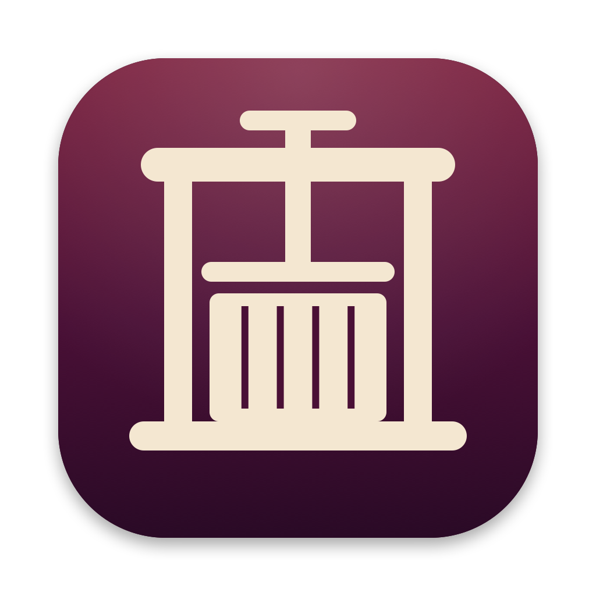
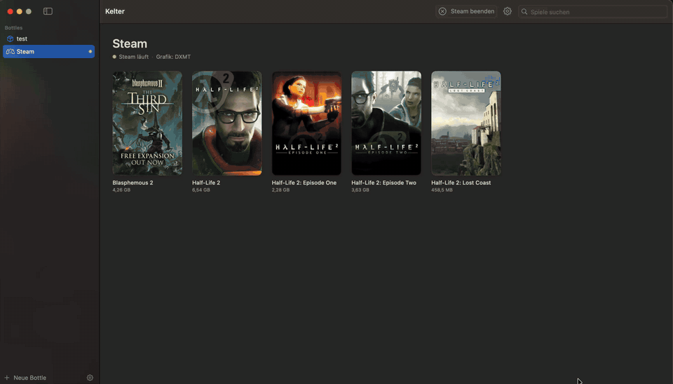
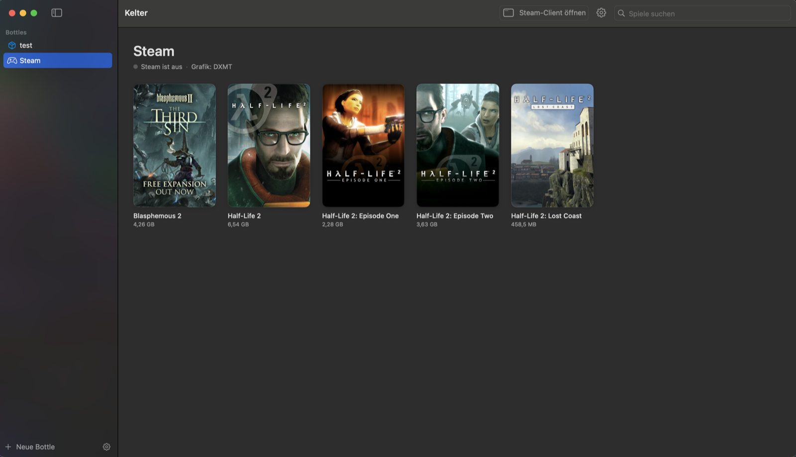

<p align="center">
  
</p>

# Kelter

**English** · [Deutsch](README.de.md)

Kelter runs Windows games from your Steam library on Apple Silicon Macs. It
sets up [Wine](https://www.winehq.org) and the Windows Steam client in a few
clicks, shows your games with their covers and starts them through Steam. A
free alternative to CrossOver, licensed under the GPLv3.

Kelter is only the front end. It downloads Wine and the graphics layers as
ready-made, maintained builds; source, version and checksum are listed in a
configuration file. Kelter ships no proprietary components.

<p align="center">
  
</p>

> **Status:** early version (0.1). Steam, the game library and DirectX 9–11
> work; DirectX 12 does not yet. [Download](#install) the app or build it
> from source.

Kelter is an independent project and is not affiliated with Valve, Apple or
CodeWeavers. Steam, macOS, DirectX and CrossOver are trademarks of their
respective owners.

## Contents

- [What works](#what-works)
- [Requirements](#requirements)
- [Install](#install)
- [Using Kelter](#using-kelter)
- [If a game doesn't start](#if-a-game-doesnt-start)
- [Limitations](#limitations)
- [How it works](#how-it-works)
- [Contributing](#contributing)
- [Credits and licenses](#credits-and-licenses)

## What works

Tested on a MacBook Air (M5) with macOS 26.6 and Wine Staging 11.21.

| Area | Status | Checked on a real Mac |
| --- | --- | --- |
| Setup: Rosetta 2, downloading Wine, creating bottles | done | yes |
| Installing Steam, signing in, starting, quitting cleanly | done | yes |
| Game library with covers, play with one click, search | done | yes |
| Graphics "Wine (built-in)" (DirectX 9–11 via OpenGL) | done | yes (Half-Life 2) |
| Graphics "DXMT" (DirectX 10/11 via Metal) | done | yes (Blasphemous 2, 60 FPS) |
| Graphics "D3DMetal" (DirectX 11/12, Apple) | built in, paused: Steam crashes with it | yes, with that result |
| Winetricks (Visual C++, fonts …) | done | yes (test bottle) |
| Environment variables and DLL overrides per bottle | done | user interface yes |
| Warning about kernel anti-cheat | done | not yet with an affected game |
| User interface in German and English | done | yes |
| Settings per game | postponed | – |
| Controllers | not documented | – |

### Tested games

| Game | DirectX | Graphics in Kelter | Result |
| --- | --- | --- | --- |
| Blasphemous 2 | 11 | DXMT | runs, 60 FPS |
| Half-Life 2 (with episodes) | 9 | Wine (built-in) | runs, occasional stutter while loading |

Reports on more games are welcome, see [Contributing](#contributing).

## Requirements

**To use Kelter**

- A Mac with Apple Silicon (M1 or later), macOS 15 or later
- Rosetta 2 (Kelter offers to install it)
- About 2 GB of free space for Wine, plus the space for your games

**To build Kelter**

- Xcode or the Command Line Tools with Swift 5.9 or later
- For Winetricks: [Homebrew](https://brew.sh) and `brew install cabextract`
- Only to build Kelter's Wine files yourself (otherwise Kelter downloads
  them): `brew install bison mingw-w64`, see
  [Kelter's changes to Wine](#kelters-changes-to-wine)

## Install

### Download

1. Download `Kelter-<version>.zip` from the
   [latest release](https://github.com/blankfourdigits/Kelter/releases/latest)
   and unzip it.
2. Move `Kelter.app` to your Applications folder.
3. **First start:** Kelter is free software and not notarized by Apple, so
   macOS blocks the first start with a message that it can't check the app.
   Click **Done**, open **System Settings → Privacy & Security**, scroll down
   and click **Open Anyway** next to the message about Kelter, then confirm.
   This is needed only once.

   Alternatively, in Terminal:
   `xattr -dr com.apple.quarantine /Applications/Kelter.app`

### Build from source

```sh
git clone https://github.com/blankfourdigits/Kelter.git
cd Kelter
bash scripts/make-app.sh
open build/Kelter.app
```

`make-app.sh` builds Kelter and creates `build/Kelter.app`, which you can move
to your Applications folder. A self-built app starts without the Gatekeeper
step above.

## Using Kelter

1. **First start:** Kelter walks you through the setup: Rosetta 2, then Wine
   (about 250 MB download). Then "Set up Steam" creates a bottle, downloads
   Valve's Steam installer and starts Steam. On its first start Steam updates
   itself, which takes a few minutes. Then sign in in the Steam window and
   install games.
2. **Library:** Bottles are listed on the left, the selected bottle's games on
   the right. Click a cover to start the game through Steam. "Open Steam
   client" opens only the Steam window, for example to install games. A green
   dot next to a bottle shows that something is running in it. The library is
   read from Steam's files, so it is there even while Steam is closed.

   
3. **Bottle settings** (gear at the top right):
   - *General:* name, Windows version, run a Windows program, Wine
     configuration, delete the bottle
   - *Graphics:* Wine (built-in) or DXMT, FPS counter, Retina mode
   - *Winetricks:* Visual C++, DirectX extras, fonts with one click
   - *Advanced:* launch options for Steam, environment variables, DLL
     overrides, verbose log
4. **Other Windows programs:** drop an `.exe` or `.msi` onto the window; it
   runs in the selected bottle.
5. **Language:** Kelter → Settings… (⌘,) or the gear at the bottom of the
   sidebar: "Same as the system", Deutsch or English. Takes effect after a
   restart, which Kelter offers.

**Which graphics?** DXMT is the right choice for most games: fast for
DirectX 10 and 11, while DirectX 9 keeps running through Wine. "Wine
(built-in)" works with everything but is slower.

**Launch options for a single game** are set in Steam itself: right-click the
game → Properties → Launch options.

**Anti-cheat:** Games with a protection against cheating that runs deep in the
system (kernel anti-cheat such as Ricochet, BattlEye or Easy Anti-Cheat) are
marked orange, and Kelter asks before starting them. They usually don't run
under Wine on the Mac.

## If a game doesn't start

1. In the bottle settings under *Advanced*, turn on "Verbose Wine log" and
   restart Steam.
2. Start the game and wait until it quits or hangs.
3. Open **View → Test view** (⌥⌘T). It shows the live log, and "Collect
   diagnostics …" creates a folder `Kelter-Diagnose-<date>-<time>` with
   Kelter's log, the bottle settings, Steam's logs, running Wine processes,
   installed games and system information.
4. Turn the verbose log off again afterwards; it grows quickly.

The diagnostics folder stays on your Mac. Steam's logs may contain your
account name; check the folder before sharing it. Kelter's log is written in
German.

Common cases:

- **Missing Windows libraries:** install "Visual C++ 2015–2022" or "Direct3D
  shader compiler" under *Winetricks*. If Kelter reports that Visual C++ is
  already installed in a newer version, Steam brought it along and there is
  nothing to do.
- **Black screen or crash at start:** try the other graphics option.

## Limitations

- **DirectX 12** doesn't work yet. Apple's D3DMetal is built in but paused
  because Steam crashes with it (see [D3DMetal](#d3dmetal-directx-12)).
- **Kernel anti-cheat** doesn't run under Wine; this affects many multiplayer
  games, for example Call of Duty, Destiny 2 or PUBG.
- **The Steam overlay** (Shift+Tab in a game) is turned off because games hang
  with it under Wine.
- **DirectX 9** runs through OpenGL and is slower in demanding games.
- **Controllers** are not tested or documented yet.
- **Settings per game** (own graphics or environment for a game) don't exist
  yet; settings apply per bottle.
- **Apple Silicon only**; Intel Macs are not supported.

## How it works

### Structure

```
Sources/
  KelterCore/   paths, configuration, bottles, log file, translation (Foundation only)
  KelterWine/   downloading and running Wine, Wine copies with a graphics layer,
                Winetricks, diagnostics, detecting running Wine
  KelterSteam/  installing, starting and quitting Steam; window fix;
                reading Steam's files (VDF), library, anti-cheat detection
  KelterApp/    SwiftUI interface: library, settings, test view
Resources/      runtimes.json, translations, icon, helper library for Steam
Tools/
  steam-ui-fix/ source and build script of the helper library for Steam's window
  wine-patches/ Kelter's two patches for Wine and their build script
  app-icon/     draws the app icon
Tests/          XCTest; Wine itself is never started in tests
```

- `WineRunner` is the only place that starts Wine. It sets `WINEPREFIX` and
  the bottle's environment, and picks the Wine tree that matches the chosen
  graphics.
- Wine writes to a log file instead of a pipe because its background processes
  outlive the program that was started. The interface follows the file.
- `BottleStore` names folders by an ID, not by the name, so renaming never
  moves a Windows environment.
- Kelter tells whether something runs in a bottle from the socket of Wine's
  background server (`/tmp/.wine-<uid>/server-<dev>-<inode>/socket`).

### Where Kelter keeps its data

Everything lives in `~/Library/Application Support/Kelter/`:

| Path | Contents |
| --- | --- |
| `Bottles/<ID>/bottle.json` | name and settings of a bottle |
| `Bottles/<ID>/prefix/` | the Windows environment (WINEPREFIX) |
| `Runtimes/wine/<version>/` | the unpacked Wine |
| `Runtimes/wine-variants/` | copies of Wine with a graphics layer |
| `Runtimes/wine-files/` | Kelter's built Wine files |
| `Runtimes/graphics/` | graphics layers (DXMT, D3DMetal if chosen) |
| `Runtimes/winetricks/` | the Winetricks script |
| `Downloads/` | downloads, including the Winetricks cache |
| `Logs/kelter.log` | output of Kelter and Wine |
| `runtimes.json` | optional: your own configuration, takes precedence |

To remove Kelter completely, delete this folder and the app.

### Configuration: `runtimes.json`

What Kelter downloads is set in `Resources/runtimes.json`, not in the code. To
change it, copy the file to `~/Library/Application Support/Kelter/runtimes.json`
and edit it there.

| Section | Contents |
| --- | --- |
| `schemaVersion` | layout of the file; increases with every structural change |
| `wine` | Wine build: name, version, URL, checksum, folders in the archive, ESync/MSync |
| `winePatches` | version and revision of Kelter's Wine changes, build script |
| `graphicsLayers` | graphics layers: download, checksum, which files go where, which Wine changes they need; for D3DMetal also license, disk image and `paused` |
| `steam` | installer, launch options and presets, window fix (`uiFix`), DLL overrides (overlay off), hidden programs (`hiddenAppIDs`) |
| `antiCheat` | app IDs and typical files for the anti-cheat warning |
| `winetricks` | version, URL, checksum, offered packages, required programs |
| `support` | extra package for Wine builds with their own graphics layers (currently unused) |

### Steam under Wine

**Steam's window was black.** It is an embedded Chromium interface that draws
from a second process, which Wine's macOS driver can't display. Chromium's
`--in-process-gpu` switch helps, but Steam doesn't pass it on to Chromium. So
before every Steam start, Kelter puts a small helper library (`winmm.dll`) into
the bottle that only `steamwebhelper.exe` loads. It forwards every call to
Wine's own winmm and adds the switch to the command line. Steam's own files
stay untouched. Source: `Tools/steam-ui-fix/winmm_proxy.c`; rebuild with
`bash Tools/steam-ui-fix/build.sh` (needs clang, lld-link and llvm-dlltool).

Kelter also starts Steam with `-cef-disable-gpu -cef-disable-gpu-compositing`;
with hardware acceleration, Chromium's graphics process crashes under Wine.
This affects only the Steam window, not the games.

**The Steam overlay** (`gameoverlayrenderer.dll`) made games hang and is
therefore turned off (`steam.dllOverrides`).

**Starting games:** Kelter reads Steam's files (`libraryfolders.vdf`,
`appmanifest_*.acf`), including libraries on other drives, takes the covers
from Steam's cache and starts a game with `steam.exe steam://rungameid/<id>`.
If Steam is already running, it takes over the start.

### Graphics

| Choice | DirectX 9 | DirectX 10/11 | DirectX 12 |
| --- | --- | --- | --- |
| Wine (built-in) | OpenGL | OpenGL | – |
| DXMT | OpenGL | Metal (DXMT) | – |
| D3DMetal (paused) | OpenGL | Metal (D3DMetal) | Metal (D3DMetal), 64-bit only |

Wine looks for its built-in libraries in its own folder first, so a graphics
layer that replaces `d3d11.dll` has to live inside a Wine tree. Kelter keeps a
copy of Wine per layer (an APFS clone that takes almost no space) and starts
each bottle with the tree that matches its choice. The Wine of all other
bottles stays untouched.

#### Kelter's changes to Wine

DXMT needs a function table in Wine's macOS driver (`macdrv_functions`) that
only CrossOver's Wine offers; without it, DXMT reports "Failed to create metal
view". D3DMetal additionally needs a change in `ntdll.dll`. Both patches are in
`Tools/wine-patches/` and are licensed under the LGPL like Wine.
`bash Tools/wine-patches/build.sh` builds the two files from Wine plus Wine
Staging in the version listed in `runtimes.json`. GitHub runs this script for
every revision (`.github/workflows/wine-files.yml`) and publishes the files
together with the complete source as a release; when you choose DXMT, Kelter
downloads them and checks the checksum from `runtimes.json`. Files you built
yourself take precedence (needs `brew install bison mingw-w64`). Kelter
copies the files only into the Wine copies of the graphics layers.

#### D3DMetal (DirectX 12)

D3DMetal is Apple's translation of DirectX 11/12 to Metal from the Game
Porting Toolkit. It belongs to Apple and is **not** part of Kelter. Apple's
license allows using it only to develop, test or evaluate games for Apple
devices, and passing it on only for non-commercial purposes. Kelter shows the
license before downloading, doesn't change Apple's files and doesn't ship
them. Sources: Apple's own disk image (with your own Apple ID) or a download
from Gcenx.

**Currently paused:** with D3DMetal, `steam.exe` crashes at start. Apple's
`dxgi.dll` starts a thread that crashes in macOS, probably because Wine 11
switches between the Windows and the Mac side differently than the older Wine
D3DMetal was built for. The choice is therefore locked (`paused` in
`runtimes.json`). Hints on how CrossOver solves this are welcome.

#### Tried and dropped

- **Sikarugir engine** (Wine 11.0 with an extra package for D9VK, DXMT, DXVK,
  D3DMetal): on the test Mac every Wine process died right after loading ntdll
  (`run_wineboot failed to start wineboot 1`), regardless of environment
  variables. `Tools/wine-test.sh` reproduces this. The code for such extra
  packages (`support` in `runtimes.json`) is still there.
- **DXVK for DirectX 9:** the macOS version of DXVK supports only DirectX
  10/11.

### Translations

The German text is the key; English translations are in
`Resources/en.lproj/Localizable.strings`. SwiftUI translates fixed texts
(`Text("…")`, `Button("…")` …) by itself; everything else goes through
`loc("… %@ …", value)`. The `LocalizationTests` test reports every displayed
text without a translation. The log stays German.

To try English without changing your setting:
`open build/Kelter.app --args -AppleLanguages '(en)'`.

### App icon

`swift Tools/app-icon/make-icon.swift` draws the icon and saves it as
`Resources/AppIcon.icns`.

## Contributing

Contributions are welcome, especially reports on games and help with
D3DMetal. To report how a game runs, open an issue with the **Game report**
form; for problems in Kelter itself, use **Bug report**. How to build and
test, and the rules for changes, are in [CONTRIBUTING.md](CONTRIBUTING.md).
Security problems please report privately, see [SECURITY.md](SECURITY.md).

## Credits and licenses

Kelter is licensed under the [GPLv3](LICENSE). It contains no code from
CrossOver and no proprietary components. Which projects Kelter downloads and
which earlier work it builds on is listed in
[THIRD_PARTY_NOTICES.md](THIRD_PARTY_NOTICES.md).
